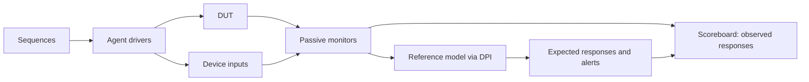
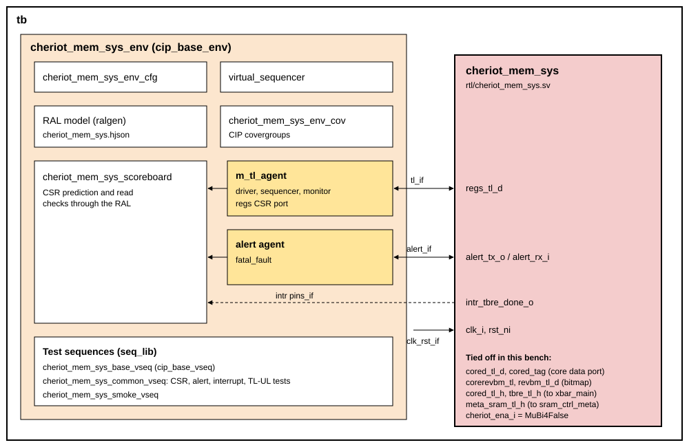

# CHERIoT Memory Subsystem DV document

## Goals
* **DV**
  * Verify all CHERIoT memory subsystem IP features by running dynamic simulations with a SV/UVM based testbench
  * Develop and run all tests based on the [testplan](#testplan) below towards closing code and functional coverage on the IP and all of its sub-modules
* **FPV**
  * Verify TileLink device protocol compliance with an SVA based testbench
  * Verify the main functional path (tag filter, WTRC, RMW filter, revocation engine) against its specification (planned)

## Current status
* [Design & verification stage](../../../README.md)
  * [HW development stages](../../../../doc/project_governance/development_stages.md)
* [Simulation results](https://reports.opentitan.org/hw/ip/cheriot_mem_sys/dv/latest/report.html)

## Design features
For detailed information on the CHERIoT memory subsystem design features, please see the [CHERIoT memory subsystem design specification](../README.md).

## Testbench architecture
This is a UVM testbench built on OpenTitan's [CIP testbench architecture](../../../dv/sv/cip_lib/README.md).
Sequences generate stimulus, agents drive and monitor the interfaces, a reference-model component
predicts responses, and a scoreboard compares them. The shared C++ model is reached through DPI;
it does not replace the UVM agents or scoreboard. The separate `cms` bench described below does
not use UVM.



### Block diagram


### Top level testbench
Top level testbench is located at `hw/ip/cheriot_mem_sys/dv/tb.sv`. It instantiates the CHERIoT memory subsystem DUT module `hw/ip/cheriot_mem_sys/rtl/cheriot_mem_sys.sv`.
In addition, it instantiates the following interfaces, connects them to the DUT and sets their handle into `uvm_config_db`:
* [Clock and reset interface](../../../dv/sv/common_ifs/README.md)
* [TileLink host interface](../../../dv/sv/tl_agent/README.md) on the `regs` port
* `cheriot_mem_sys_core_if` on the core data port: TL-UL, the tag sideband (`cored_tag_h2d_i`, `cored_tag_d2h_o`) and `cheriot_ena_i`
* TileLink host interfaces on the revocation bitmap ports (`corerevbm_tl`, `revbm_tl_d`)
* TileLink device interfaces on the host ports towards the main crossbar (`cored_tl_h`, `tbre_tl_h`) and the meta SRAM (`meta_sram_tl`)
* Optional `cheriot_mem_sys_meta_if` debugging taps (`+cms_meta_trace`): `uvm_info` prints only
* Interrupts ([`pins_if`](../../../dv/sv/common_ifs/README.md))
* [Alerts interface](../../../dv/sv/alert_agent/README.md)

The DUT is built with Earl Grey 2's address map, or with a small one (16 KiB SRAM, 8 KiB NVM; build mode `cms_map`) for the feature tests, which fill and sweep whole regions.

### Common DV utility components
The following utilities provide generic helper tasks and functions to perform activities that are common across the project:
* [dv_utils_pkg](../../../dv/sv/dv_utils/README.md)
* [csr_utils_pkg](../../../dv/sv/csr_utils/README.md)

### Global types & methods
All common types and methods defined at the package level can be found in `env/cheriot_mem_sys_env_pkg`: the address map, the meta SRAM map, the TBRE_STATUS fields, capability permissions, the fault kinds the memory devices inject, and the capability encoding helpers (`cap_base`, `cap_meta`, `revbm_index`, `tag_word_addr`).

### Agents
* **Core agent** (`core_agent/`, `cheriot_mem_sys_core_agent`): the core on the core data port.
  Its item (`cheriot_mem_sys_core_item`) is one access with its tag (store tag, or capability-load hint) and its response with the response tag.
  The driver presents one request at a time, with its tag, holds it until it is taken, and keeps up to two in flight, as Ibex does.
  The monitor publishes each completed access with both tags and the mode at the request's handshake.
* **TL-UL host agents** ([tl_agent](../../../dv/sv/tl_agent/README.md)) on `regs` (from the CIP environment), `revbm_tl_d` and `corerevbm_tl`.
* **TL-UL device agents** on `cored_tl_h`, `tbre_tl_h` and `meta_sram_tl`, answered by `cheriot_mem_sys_mem_device_seq`: a memory with the crossbar's error range and read-only NVM, and fault injection (an error response, a corrupted response or data integrity) by address range, direction and count.
* **Alert agent** on `fatal_fault` (from the CIP environment).

### UVM RAL Model
The CHERIoT memory subsystem RAL model is created with the [`ralgen`](../../../dv/tools/ralgen/README.md) FuseSoC generator script automatically when the simulation is at the build stage.

It can be created manually by invoking [`regtool`](../../../../util/reggen/doc/setup_and_use.md).

### Stimulus strategy
#### Tests and test sequences
Every test is in its own file in `hw/ip/cheriot_mem_sys/dv/tests` (package `cheriot_mem_sys_test_pkg`) and names the virtual sequence it runs.
The sequences reside in `hw/ip/cheriot_mem_sys/dv/env/seq_lib`, one per test, each describing what it checks.
They extend `cheriot_mem_sys_base_vseq`, which brings the environment up (reset, the memories preloaded, the memory devices started) and provides the operations the sequences are written in:
* core accesses (`core_store`, `core_load`, `core_store_cap`, `core_load_cap`, `core_issue`), each a `cheriot_mem_sys_core_access_seq` on the core agent
* bitmap accesses on the two bitmap agents, register accesses through the RAL, and malformed register accesses on the `regs` agent
* sweeps (`tbre_sweep`, `tbre_wait_idle`, `tbre_wait_intr`), resets and fault injection

`cheriot_mem_sys_common_vseq` runs the common CSR, alert, interrupt and TL-UL tests.

#### Functional coverage
`cheriot_mem_sys_env_cov` samples, from the scoreboard:
* `core_access_cg`: every core access by opcode, size, tag, mode, region, error and response tag, crossed
* `bitmap_access_cg`: the bitmap ports by opcode and error

The CIP covergroups (CSR, interrupt and alert) are collected as well.

### Self-checking strategy
#### Scoreboard
`cheriot_mem_sys_scoreboard` maintains the RAL and compares observed responses with predictions
from `cheriot_mem_sys_ref_model`. The latter uses the specification-based C++ model in
[`cms/cmodel`](cms/cmodel/README.md). The feature tests enable this model; common CIP tests use
the RAL checks. Registers changed autonomously by the revocation engine are excluded from the
common RAL comparison.

The core and bitmap comparisons check errors, data and response integrity. Incoming memory faults
are inputs to the subsystem, so a forwarded integrity fault must retain its syndrome rather than
be repaired or changed. Predictions, requester ownership and every check depend only on external
ports and independent model state. Outstanding external core/bitmap requests and the programmed
sweep determine the possible recipients of an injected meta-memory fault. If two requests overlap
and the external ports cannot identify the recipient, each retains all documented alternatives:
core error/tag and sweep error/tag may each be either outcome. Unhinted and unaligned loads do
not look up a tag and cannot acquire a sweep's tag fault. Counter alternatives and ambiguous writes
are retained in model state, without learning which outcome the DUT chose.

The internal `cheriot_mem_sys_meta_monitor` has no analysis port and performs no checks. With
`+cms_meta_trace` it only prints what the DUT routed with `uvm_info`; with the option absent it is
not created. Nothing expected, owned or checked may depend on these taps.

A START write takes
effect in the model when accepted, including a byte-enabled write; a delayed acknowledgement must
not erase a fault that the running sweep has already encountered.

Open tags retain both values in the independent model state. A separate relational check requires
stable repeated reads between possible mutations and equal tags across an aligned read and its
following unaligned response. Observations never resolve the independently predicted memory.
A device error aborts a tag update and preserves the old tag. **Q43 remains open:** after an
integrity-only RMW fault, the write-back and resulting tag are not judged as either abort or commit.

The reference model predicts alerts and the scoreboard matches them, including across reset.
At quiet points and test end the meta SRAM is compared word by word. Quiet means no monitored
transaction remains outstanding, rather than a fixed delay since the last request. An unexplained
response, alert or unfinished transaction is a failure.

#### Assertions
* TLUL assertions: The `sva/cheriot_mem_sys_bind.sv` binds the `tlul_assert` [assertions](../../tlul/doc/TlulProtocolChecker.md) to the IP to ensure TileLink interface protocol compliance on every port: the `regs`, `cored_tl_d`, `corerevbm_tl` and `revbm_tl_d` device ports and the `cored`, `tbre` and `meta_sram` host ports
* CSR assertions: The `sva/cheriot_mem_sys_bind.sv` binds the generated `cheriot_mem_sys_regs_csr_assert_fpv` checks
* Unknown checks on DUT outputs: The RTL has assertions to ensure all outputs are initialized to known values after coming out of reset

## Second testbench: EG2 `cms`
The CHERIoT memory subsystem has a second testbench, built for Earl Grey 2: `cms`, in [`dv/cms`](cms/README.md). It is a class-based SystemVerilog testbench (its own TL-UL drivers, monitors and scoreboard; no UVM library, no RAL), so it also runs on Verilator.
The feature tests of this testbench were ported from it.
Its scoreboard predicts tags, data, the WTRC, the revocation sweep (including its races with core stores), the registers and the meta SRAM from the design specification.
The C reference model of the subsystem (`dv/cms/cmodel`) is shared by both testbenches.
Its testplan is [`cheriot_mem_sys_cms_testplan.hjson`](../data/cheriot_mem_sys_cms_testplan.hjson) (39 testpoints, 14 covergroups).

## Building and running tests
The [dvsim](https://github.com/lowRISC/dvsim) tool is used for building and running our tests and regressions.
Please take a look at the link for detailed information on the usage, capabilities, features and known issues.
Here's how to run the smoke test, and all the feature tests:
```console
$ dvsim $REPO_TOP/hw/ip/cheriot_mem_sys/dv/cheriot_mem_sys_sim_cfg.hjson -i cheriot_mem_sys_tag_smoke
$ dvsim $REPO_TOP/hw/ip/cheriot_mem_sys/dv/cheriot_mem_sys_sim_cfg.hjson -i feature --fixed-seed 1110
$ dvsim $REPO_TOP/hw/ip/cheriot_mem_sys/dv/cheriot_mem_sys_sim_cfg.hjson -i feature --fixed-seed 1111
```

The feature regression includes `cheriot_mem_sys_cmodel_random_inject_fail`, which deliberately
corrupts a compared data bit and must fail at that comparison. Do not count a build error or an
unrelated failure as detection. `--fixed-seed` applies a seed to every test; `--seeds` supplies a
list consumed across the tests and does not repeat one seed for the whole regression.

## Testplan
[Testplan](../data/cheriot_mem_sys_testplan.hjson)

The `cms` testbench: [testplan](../data/cheriot_mem_sys_cms_testplan.hjson)
