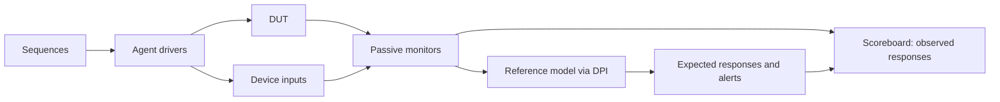

# CHERIoT Memory Subsystem DV document

## Goals
* **DV**
  * Verify all CHERIoT memory subsystem IP features by running dynamic simulations with a SV/UVM based testbench
  * Develop and run all tests based on the [testplan](#testplan) below towards closing code and functional coverage on the IP and all of its sub-modules
* **FPV**
  * Verify TileLink device protocol compliance with an SVA based testbench
  * Verify the main functional path (tag filter, WTRC, RMW filter, revocation engine) against its specification (planned)

## Current status
* [Design & verification stage](../../../README.md)
  * [HW development stages](../../../../doc/project_governance/development_stages.md)
* [Simulation results](https://reports.opentitan.org/hw/ip/cheriot_mem_sys/dv/latest/report.html)

## Design features
For detailed information on the CHERIoT memory subsystem design features, please see the [CHERIoT memory subsystem design specification](../README.md).
The combined subsystem and revocation verification plan is in the `eg2_top_verification`
harness repository at `test-specifications/cheriot_mem_sys_revocation_verification_spec.md`.

## Testbench architecture
This is a UVM testbench built on OpenTitan's [CIP testbench architecture](../../../dv/sv/cip_lib/README.md).
Sequences generate stimulus, agents drive and monitor the interfaces, a reference-model component
predicts responses, and a scoreboard compares them. The shared C++ model is reached through DPI;
it does not replace the UVM agents or scoreboard. This is the maintained subsystem bench.



### Block diagram


### Top level testbench
Top level testbench is located at `hw/ip/cheriot_mem_sys/dv/tb.sv`. It instantiates the CHERIoT memory subsystem DUT module `hw/ip/cheriot_mem_sys/rtl/cheriot_mem_sys.sv`.
In addition, it instantiates the following interfaces, connects them to the DUT and sets their handle into `uvm_config_db`:
* [Clock and reset interface](../../../dv/sv/common_ifs/README.md)
* [TileLink host interface](../../../dv/sv/tl_agent/README.md) on the `regs` port
* `cheriot_mem_sys_core_if` on the core data port: TL-UL, the tag sideband (`cored_tag_h2d_i`, `cored_tag_d2h_o`) and `cheriot_ena_i`
* TileLink host interfaces on the revocation bitmap ports (`corerevbm_tl`, `revbm_tl_d`)
* TileLink device interfaces on the host ports towards the main crossbar (`cored_tl_h`, `tbre_tl_h`) and the meta SRAM (`meta_sram_tl`)
* Optional `cheriot_mem_sys_meta_if` debugging taps (`+cms_meta_trace`): `uvm_info` prints only
* Interrupts ([`pins_if`](../../../dv/sv/common_ifs/README.md))
* [Alerts interface](../../../dv/sv/alert_agent/README.md)

The DUT is built with Earl Grey 2's address map, or with a small one (16 KiB SRAM, 8 KiB NVM; build mode `cms_map`) for the feature tests, which fill and sweep whole regions.

### Common DV utility components
The following utilities provide generic helper tasks and functions to perform activities that are common across the project:
* [dv_utils_pkg](../../../dv/sv/dv_utils/README.md)
* [csr_utils_pkg](../../../dv/sv/csr_utils/README.md)

### Global types & methods
All common types and methods defined at the package level can be found in `env/cheriot_mem_sys_env_pkg`: the address map, the meta SRAM map, the TBRE_STATUS fields, capability permissions, the fault kinds the memory devices inject, and the capability encoding helpers (`cap_base`, `cap_meta`, `revbm_index`, `tag_word_addr`).

### Agents
* **Core agent** (`core_agent/`, `cheriot_mem_sys_core_agent`): the core on the core data port.
  Its item (`cheriot_mem_sys_core_item`) is one access with its tag (store tag, or capability-load hint) and its response with the response tag.
  The driver presents one request at a time, with its tag, holds it until it is taken, and keeps up to two in flight, as Ibex does.
  The monitor publishes each completed access with both tags and the mode at the request's handshake.
* **TL-UL host agents** ([tl_agent](../../../dv/sv/tl_agent/README.md)) on `regs` (from the CIP environment), `revbm_tl_d` and `corerevbm_tl`.
* **TL-UL device agents** on `cored_tl_h`, `tbre_tl_h` and `meta_sram_tl`, answered by `cheriot_mem_sys_mem_device_seq`: a memory with the crossbar's error range and read-only NVM, and fault injection (an error response, a corrupted response or data integrity) by address range, direction and count.
* **Alert agent** on `fatal_fault` (from the CIP environment).

### UVM RAL Model
The CHERIoT memory subsystem RAL model is created with the [`ralgen`](../../../dv/tools/ralgen/README.md) FuseSoC generator script automatically when the simulation is at the build stage.

It can be created manually by invoking [`regtool`](../../../../util/reggen/doc/setup_and_use.md).

### Stimulus strategy
#### Tests and test sequences
Every feature test is one virtual-sequence file in `hw/ip/cheriot_mem_sys/dv/env/seq_lib`,
whose header describes its checks and requirements, plus its testlist entry. All entries use
`cheriot_mem_sys_base_test`; `uvm_test_seq` selects the sequence and
`+cheriot_mem_sys_cmodel=1` enables the model through the base test configuration.
Only the base test and package remain in `dv/tests`. The `_inject_fail` entry reuses the random
sequence with a corruption plusarg. Common CIP entries and checking are unchanged.
They extend `cheriot_mem_sys_base_vseq`, which brings the environment up (reset, the memories preloaded, the memory devices started) and provides the operations the sequences are written in:
* core accesses (`core_store`, `core_load`, `core_store_cap`, `core_load_cap`, `core_issue`), each a `cheriot_mem_sys_core_access_seq` on the core agent
* bitmap accesses on the two bitmap agents, register accesses through the RAL, and malformed register accesses on the `regs` agent
* sweeps (`tbre_sweep`, `tbre_wait_idle`, `tbre_wait_intr`), resets and fault injection

`cheriot_mem_sys_common_vseq` runs the common CSR, alert, interrupt and TL-UL tests.
The standard `sec_cm` entry injects the register write-enable checker through
`sec_cm_prim_onehot_check_bind` and checks the external TL error and fatal alert.
Its hook requires the register-checker proxy to exist. In this fork the standard
`tl_intg_err` entry comes from `tl_access_tests.hjson`.

The `closure` regression contains the seven directed families in order: WTRC
handoffs, NVM corners, core matrix, combined revocation causes, bitmap boundaries,
ambiguous overlaps, invalidation-write error. The feature regression also includes
these and the CSR byte-enable and legal toggle-sweep sequences. Bitmap boundaries
and toggle sweeps use the full EG2 map. Presentation-only driver controls allow a
third stalled request without increasing accepted depth; the monitor retires an
older response before publishing the same edge's next request. Combined faults
are applied by one descriptor to one external memory response.

#### Functional coverage
`cheriot_mem_sys_env_cov` samples, from the scoreboard:
* `core_access_cg`: every core access by opcode, size, tag, mode, region, error and response tag, crossed
* `bitmap_access_cg`: the bitmap ports by opcode and error
* `cms_sweep_cap_cg`, `cms_tbre_start_cg`, `cms_tbre_end_cg`: independent sweep candidates, starts and completion
* `cms_sweep_snoop_cg`, `cms_sweep_race_cg`: core stores relative to external sweep reads and model candidates
* `cms_nvm_cap_cg`: NVM capability-store word, match/sequence outcome and old tag
* `cms_meta_access_cg`: bitmap-window legality, port and direction

The scoreboard samples these from monitor items and read-only model snapshots. Set-valued tag,
bitmap and fault states retain false/true/either; uncertainty is not counted as a definite outcome.
Snoop timing uses external read handshakes; before a lower-word handshake the presentation boundary
is uncertain, so it samples `around`, never a claimed internal `early` boundary.

`sva/cheriot_mem_subsys_fcov.sv` and the existing bind file add the RTL tag-filter request/response,
RMW, TBRE mover, access-checker, top and WTRC covergroups with `+en_cov=1`. They observe internals
**for coverage only**: no assertions, expected values, ownership or checking depend on them.
Sources are the current source repositories, not the retired EG2 copies: `cheriot-mem-ss`
`af1dbb2` (descends from `90f7c7c`), `cheriot-rtos-test-suite` `ae3b0bb`, and Ibex `7220d4f2`.
The RTOS file has eight covergroups, including the excluded SoC shim `rev_ctl_tbre_cg`.
`sva/cheriot_trvk_fcov.sv` adapts Ibex's decision, base bit, sealing, window and lookup-error
coverage to `cheriot_trvk_core`. The non-power-of-two window group exists only for maps with
that boundary band. Core instruction/LSU coverage remains in Ibex.

The latest Ibex `core_ibex_fcov_if.sv` lists the old TBRE points in a BLOCKED comment, without
implementations. Their applicable meanings are mapped to the mover: FSM to `cp_running` and
`cp_drain`, outstanding count to `cp_inflight`, memory faults to `cp_errs`, concurrent requests
to `cp_concur_mem_reqs`. `cp_tbre_fifo_hazard` and `cp_tbrewrp_blk1_cancel` are dropped: they
describe the old core's FIFO hazard and wrapper block cancellation, neither a documented
operation of `cheriot_tbre_mover`. Its current stale-store handling is covered by `cp_snoop`,
`cp_outcome`, the top's race/clear-squash points and the external race tests.

Crosses omit impossible tagged partial stores, tag-1 returns with CHERIoT off, bitmap outcomes
outside the bitmap window, and tag-1 upper-word lookup responses (upper loads use the sticky tag).
The unobservable pre-presentation snoop bin is explicitly ignored; external timing records
`around` instead. Unhit reachable bins remain coverage gaps, not exclusions.
The former `cms` bench supplied no SVA beyond the small core-interface checks now maintained here.

The CIP covergroups (CSR, interrupt and alert) are collected as well.

#### Code and assertion coverage measurement

The block-local `cov/cheriot_mem_sys.ccf` enables Xcelium's
`set_parameterized_module_coverage -type_parameters_only`. Without it, `COVUTP` warns that
the seven RTL modules with `parameter type addr_t` lack code coverage. Both ordinary and
`cover_reg_top` builds select this CCF; shared OpenTitan CCFs remain unchanged. Type-only
specialization retains compatible type names across the default and `cms_map` address maps.
Every merge must still be checked for conflicts, dropped items and dropped runs.

The same block configuration selects internal-net toggles for those seven modules and FSM
arcs. Report block, branch, statement, expression, toggle and FSM coverage separately, with
explicit state/transition/arc counts. N/A means no scored items, not 100%. Report the CMS RTL
types separately from the cumulative hierarchy containing shared primitives. Older percentages
collected without parameterized-module coverage are not subsystem code-coverage measurements.

`core_access_cg.cp_mode` samples an integral four-bit value with 16 individual encoding bins;
operation crosses use the separate CHERIoT/ePMP/invalid classification. Successful partial NVM
writes and TBRE's locally generated write-response integrity fault are explicitly ignored,
with source comments explaining why they are unreachable through the external interfaces.
Assertion reports distinguish original macro-name presence from recorded finishes and failures.

### Self-checking strategy
#### Scoreboard
`cheriot_mem_sys_scoreboard` maintains the RAL and compares observed responses with predictions
from `cheriot_mem_sys_ref_model`. The latter uses the specification-based C++ model in
[`cmodel`](cmodel/README.md). The feature tests enable this model; common CIP tests use
the RAL checks. Registers changed autonomously by the revocation engine are excluded from the
common RAL comparison.

The core and bitmap comparisons check errors, data and response integrity. Incoming memory faults
are inputs to the subsystem, so a forwarded integrity fault must retain its syndrome rather than
be repaired or changed. Predictions, requester ownership and every check depend only on external
ports and independent model state. Outstanding external core/bitmap requests and the programmed
sweep determine the possible recipients of an injected meta-memory fault. If two requests overlap
and the external ports cannot identify the recipient, each retains all documented alternatives:
core error/tag and sweep error/tag may each be either outcome. Unhinted and unaligned loads do
not look up a tag and cannot acquire a sweep's tag fault. Counter alternatives and ambiguous writes
are retained in model state, without learning which outcome the DUT chose.

The internal `cheriot_mem_sys_meta_monitor` has no analysis port and performs no checks. With
`+cms_meta_trace` it only prints what the DUT routed with `uvm_info`; with the option absent it is
not created. Nothing expected, owned or checked may depend on these taps.

A START write takes
effect in the model when accepted, including a byte-enabled write; a delayed acknowledgement must
not erase a fault that the running sweep has already encountered.

Open tags retain both values in the independent model state. A separate relational check requires
stable repeated reads between possible mutations and equal tags across an aligned read and its
following unaligned response. Observations never resolve the independently predicted memory.
A device error aborts a tag update and preserves the old tag. **Q43 remains open:** after an
integrity-only RMW fault, the write-back and resulting tag are not judged as either abort or commit.

The reference model predicts alerts and the scoreboard matches them, including across reset.
At quiet points and test end the meta SRAM is compared word by word. Quiet means no monitored
transaction remains outstanding, rather than a fixed delay since the last request. An unexplained
response, alert or unfinished transaction is a failure.

#### Assertions
* TLUL assertions: The `sva/cheriot_mem_sys_bind.sv` binds the `tlul_assert` [assertions](../../tlul/doc/TlulProtocolChecker.md) to the IP to ensure TileLink interface protocol compliance on every port: the `regs`, `cored_tl_d`, `corerevbm_tl` and `revbm_tl_d` device ports and the `cored`, `tbre` and `meta_sram` host ports
* CSR assertions: The `sva/cheriot_mem_sys_bind.sv` binds the generated `cheriot_mem_sys_regs_csr_assert_fpv` checks
* Core interface: request-tag stability during backpressure, known response tags when valid,
  and a known execution mode. `CoreModeStable_BenchAssumption_A` enforces **bench assumption A6**:
  no mode change from request presentation through the last outstanding response. Q8/Q48 are
  still open; this does not claim RTL support for mid-access mode switching. Three cover properties
  witness stalls, responses and outstanding accesses. Xcelium's CMS coverage configuration selects
  these assertions explicitly. Add `--build-opts="-covdut tb"` to coverage runs so that Xcelium
  instruments the sibling interface as well as the DUT; the common DUT-only scope excludes it.
* Assertion control: only `tb.sv` disables assertions, only in the core WTRC instance, around
  malformed stores that a real core cannot issue. The RTL assertions are unchanged.
* Unknown checks on DUT outputs: The RTL has assertions to ensure all outputs are initialized to known values after coming out of reset

## Consolidated tests and declared gaps

The maintained sequences also cover reset during an active sweep, external-request/response-timed
store races, and the 40,000-operation `random_long` entry (the `mixed_random` sequence).
The `known_gaps` regression contains external latency/backpressure checks and seven TRVK fault
sites. A TRVK pulse is a write-only fault actuator; its timing comes from external ports and its
effectiveness from a later external tag read. No internal value qualifies an injection or verdict.
The declared injected granule alone may retain either tag; other comparisons remain active.

| Requirement/countermeasure | Status |
|---|---|
| REQ_CMS_01 / CORED_TAG.INTERSIG.MUBI | Known gap: one-bit sidebands, no MuBi4 encoding (TODO #31066); `tests: []` |
| REQ_CMS_02 / LOGIC.SHADOW | Known gap: no lockstep copy (TODO #30572); `tests: []`; TRVK fault probes are separate evidence |
| REQ_CMS_07 | Existing extra-cycle latency gap; measured at external core/crossbar ports, never counted as a pass |
| Internal TRVK verdict latency / per-owner bitmap outstanding count | Unobservable from this IP's external ports under overlap; not checked using internal taps |
| NVM capability-store command integrity | CMS-NVM-CMD-INTG fixed by `269afde566`: `err_cmd_intg` passes with the documented error/no-change/alert contract; retained as a regression test |
| Ordinary core and bitmap command integrity | CMS-CMD-INTG question: no documented response/alert contract; no invented check |

`sec_cm_intersig_mubi`, `sec_cm_mem_sw_noaccess` and `sec_cm_bus_integrity` map to their actual
feature/common tests in the countermeasure testplan. BUS.INTEGRITY's end-to-end guarantee also
relies on the missing LOGIC.SHADOW. The NVM capability-store command/data-integrity contract is
checked by `err_cmd_intg`. The register-port isolation cases use reserved local offsets; rejection
of every absolute high-address alias is not claimed (the register port decodes local CSR offsets).

`checker_negative` contains the ported data, tag/sticky-tag, sweep, bitmap, error, race, epoch,
latency, TRVK and backpressure corruption twins. Every twin must hit its named corruption and
fail at the intended comparison. Build failure, an inactive injection or an unrelated failure
is not detection. The old MUBI/lockstep tests and their corruption twins are replaced by the two
explicit missing-RTL gaps above; they cannot prove implemented countermeasures.

## Building and running tests
The [dvsim](https://github.com/lowRISC/dvsim) tool is used for building and running our tests and regressions.
Please take a look at the link for detailed information on the usage, capabilities, features and known issues.
Here's how to run the smoke test, and all the feature tests:
```console
$ dvsim $REPO_TOP/hw/ip/cheriot_mem_sys/dv/cheriot_mem_sys_sim_cfg.hjson -i cheriot_mem_sys_tag_smoke
$ dvsim $REPO_TOP/hw/ip/cheriot_mem_sys/dv/cheriot_mem_sys_sim_cfg.hjson -i feature --fixed-seed 1110
$ dvsim $REPO_TOP/hw/ip/cheriot_mem_sys/dv/cheriot_mem_sys_sim_cfg.hjson -i feature --fixed-seed 1111
```

The feature regression includes `cheriot_mem_sys_cmodel_random_inject_fail`, which deliberately
corrupts a compared data bit and must fail at that comparison. Do not count a build error or an
unrelated failure as detection. `--fixed-seed` applies a seed to every test; `--seeds` supplies a
list consumed across the tests and does not repeat one seed for the whole regression.

## Testplan
[Testplan](../data/cheriot_mem_sys_testplan.hjson)

The former standalone `dv/cms` flow is retired after consolidation; use the UVM testplan above.

The corrected measurement on `4687cbfed2`, containing the WTRC command-integrity fix
`269afde566`, was run on 2026-11-11: all 29 functional feature tests pass at each of seeds 1110
and 1111, the intentional checker twin fails as intended, and all ten common tests pass.
`err_cmd_intg` changes from failing to passing at both seeds. Historical runs on `cde6b0a7e0`
remain in the harness's `evidence/cms-restructure-1111`; the corrected evidence is in
`evidence/cms-coverage-1111` and `test-reports/cheriot_mem_sys_verification_report.md`.

The 68 passing databases merge with no conflicts or dropped items/runs. All 18 CMS groups
sample: 485/532 graded bins hit, 47 unhit; all 16 raw mode encodings hit. The two documented
impossible functional bins are explicitly ignored. All seven type-parameterized modules now
have code coverage: their combined block/branch/statement/expression/toggle/FSM percentages
are 98.71/97.36/98.29/94.12/74.67/92.31. Detailed counts, scope and tool limits are in the report.
Of 88 original RTL assertion macro names, 87 are present and 86 record finishes, with no
failures. `UnknownArbImpl_A` is unelaborated; the register write-enable fault property lacks a
fault campaign. All four interface assertions and three witnesses record finishes.

Those figures describe the measurement baseline. The closure checkpoint on
`c857e6c834` plus the uncommitted bench passes all 38 positive feature tests at
each seed 1110/1111 and all 11 common tests, including `sec_cm`; both intentional
checker-negative twins are detected. Targeted NVM and CSR byte-enable reruns at
both seeds add the held-W1 and zero-INTR_TEST controls and narrow assertion disabling.
The 87 passing databases merge without conflicts or omissions: CMS 532/532 bins,
interrupts 31/31, all 87 elaborated RTL assertion names with finishes and no failures.
The register write-enable property has 20 finishes; a separate custom fault campaign
is unnecessary. All 16 RTL mutations and 41 original pairs are caught in a complete
repeat, with passing unmutated controls. Initial misses and their fixes remain in
the evidence, separate from checker-corruption tests.

Seven-module block/branch/statement/expression/toggle/FSM coverage is
99.14/98.24/98.67/96.69/77.10/100.00%. No new exclusion is applied. Results and all
remaining hole dispositions live in the harness's `evidence/cms-closure-1111` and
`test-reports/cheriot_mem_sys_verification_report.md`. Shared outstanding-depth bins,
fixed/bounded toggles and event expressions still need Claude's UNR and review.
REQ_CMS_01 and REQ_CMS_02 remain known RTL gaps, not passes. Final sign-off also
requires the reviewed flows, designer decisions and a frozen-revision rerun.

### RTL mutation evidence

`mutation/manifest.json` preserves the retired bench's 16 mutations and 41
test/mutation pairs from `cde6b0a7e0`. Run `-i rtl_mutations --fixed-seed 1110
--reseed 1` without coverage, then run `python3 mutation/check.py <scratch-path>
--out <evidence-directory>`. This uses a separate `cms_mutation` build. Nonzero
DVSim exits are expected; the grader distinguishes an independent checker failure
from a bare RTL assertion, timeout, inactive force or missing log. Internal forces
plant faults and their activity diagnostics qualify the experiment; neither feeds
the functional model or checker. The build refuses enabled coverage. Normal
unmutated feature tests provide the positive controls, and checker-corruption
twins remain separate evidence.

For the gap and negative campaigns (their nonzero exits require classification, not a green pass):

```console
dvsim hw/ip/cheriot_mem_sys/dv/cheriot_mem_sys_sim_cfg.hjson --tool xcelium -i known_gaps --fixed-seed 1110 --reseed 1
dvsim hw/ip/cheriot_mem_sys/dv/cheriot_mem_sys_sim_cfg.hjson --tool xcelium -i checker_negative --fixed-seed 1110 --reseed 1
dvsim hw/ip/cheriot_mem_sys/dv/cheriot_mem_sys_sim_cfg.hjson --tool xcelium -i feature --fixed-seed 1110 --reseed 1 --cov --build-opts="-covdut tb" --map-full-testplan
```
