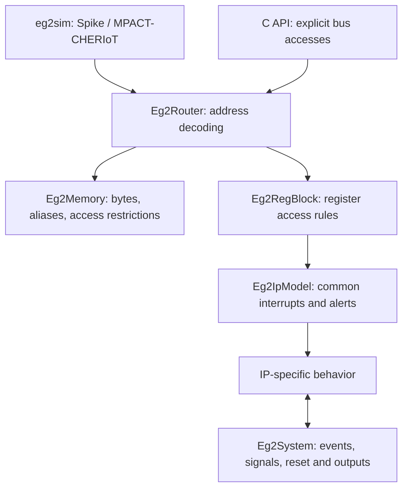

# Reading the model

The useful starting point is a firmware action: a write to a register, a memory
load, or a wait for an interrupt. Each action passes through a small set of shared
layers before reaching an IP-specific class.

## Read in this order

1. [`eg2_router.h`](../eg2_router.h): how an address selects a target.
2. [`eg2_regblock.h`](../eg2_regblock.h): what a register read or write does.
3. [`eg2_ip_model.h`](../eg2_ip_model.h): the common interrupt and alert rules.
4. [`ip/eg2_periph_gpio.h`](../ip/eg2_periph_gpio.h): a concrete device with
   input, output, register mirrors and interrupts.
5. [`eg2_system.h`](../eg2_system.h): the shared services devices call.
6. [`eg2sim.cc`](../eg2sim.cc) and [`dpi/eg2_sysmodel.cc`](../dpi/eg2_sysmodel.cc):
   how the two drivers assemble and run the platform.

The standalone driver's image operations live in
[`eg2_image.cc`](../eg2_image.cc), and its stimulus parser in
[`eg2_stimulus.cc`](../eg2_stimulus.cc). Spike's debug operations live in
[`eg2_spike_debug.cc`](../eg2_spike_debug.cc); stepping and TLM access remain in
`eg2_spike_cpu.cc`.

The memory, peripheral-system and crypto group headers collect device headers
without implementing several devices in one file. Their existing include names
remain supported. The README's group table maps each entry point to its device
files. Device headers can also be included directly.

The generated `eg2_model_regs.h` is large because it contains the register
descriptions for the whole top. It holds data, not a second implementation of the
devices. Find a device by its `namespace`, then consult that device's HJSON for
the meaning of a field.

## One register write

Suppose software writes a GPIO output register.

1. The CPU adapter sends a TLM transaction with an absolute bus address.
2. `Eg2Router` chooses the first matching window, subtracts its base address and
   forwards the transaction. It restores the original address before returning.
3. `Eg2RegBlock` finds the register and checks that the access covers the required
   byte lanes. A write blocked by `REGWEN` stops here, including its side effects.
4. The device's `reg_before_write()` hook may reject the write. The register layer
   then applies field access policies, such as read-only or write-one-to-clear.
5. `Eg2IpModel` handles common registers such as `INTR_ENABLE`, then calls the
   device's `reg_write()`. The hook receives the old value, the written data and
   the byte mask; `value(reg)` now contains the updated register value.
6. The GPIO model updates its output state and its alternate register views.
   If the driven pads changed, it emits an output item.

The read path has separate before-read and after-read hooks. A timer can update
its count before the value is returned; a FIFO can remove the returned item
afterward. Keep these two operations separate when writing a device model.

## What the crossbar abstraction does

`Eg2Router` is an address decoder, not a simulated RTL crossbar. It has one
outgoing socket per address window and forwards one transaction at a time. It
does not need a matrix of queues, arbiters or pipeline stages for this functional
model.

The window table comes from the top configuration. A missing address returns a
bus error, unless the board explicitly supplies a final default responder.
Overlaps are resolved in table order. On Earl Grey, the first 3 KiB of meta SRAM
is also the revocation bitmap. Both targets must share storage; initializing
meta SRAM must therefore clear the bitmap as well. The DPI adapter also shares
the knowledge flags for these bytes.

Large address spans do not imply dense register storage. `Eg2RegBlock` uses an
offset lookup and a vector of actual registers. For example, the PLIC's widely
spaced registers do not require allocating one value per address in its window.

Direct memory interface (DMI) requests let CPU adapters access memory bytes
without repeating a TLM transaction. Restricted windows may deny DMI. The
router translates the granted offset range back to absolute addresses.

## Interrupts and alerts

An event interrupt records something that happened and remains set until
software clears it. A status interrupt reflects a condition that is still true,
such as a FIFO threshold. `Eg2IpModel` preserves this distinction, combines the
state with `INTR_ENABLE`, and drives the appropriate PLIC source.

The PLIC chooses the highest-priority pending enabled source; the lower source
ID wins a tie. Its threshold gates interrupt notification, not a software claim.
Reading the claim register consumes the pending request even if the threshold
suppressed notification. Writing a completion releases the gateway so it can
accept the source again. Observing a different claim in RTL must never replace
this internal state.

`ALERT_TEST` is separate from interrupts. On descriptions with its bit-31 lock,
the lock value before the write determines whether an alert can be raised. A
write may raise its final test alert and clear the lock at the same time.
Subsequent tests are disabled until reset.

## Time and reset

`Eg2System` expresses time in picoseconds. It converts clock cycles using the
configured clock history. An IP schedules its next meaningful event rather than
running a busy loop. There is one scheduled event per IP; a new `schedule()`
replaces its previous request. `run_due()` collects due IPs before calling them,
so an IP that reschedules itself in the past cannot loop forever in that call.

The standalone CPU advances logical time as it executes or sleeps. The DPI
driver advances it explicitly. Neither mechanism proves hardware timing.

A system reset first calls every model's `before_reset()` hook, allowing crash
information to be captured. It then clears transient halt/escalation state and
calls `on_reset()`. `Eg2IpModel::keeps_state()` defines which register state
survives each reset cause. A derived model must apply the same decision to its
private state and events; calling the base alone does not reset private queues.

Some delayed callbacks represent external test stimuli and intentionally survive
a chip reset. Do not clear all callbacks indiscriminately: distinguish external
stimulus from device work, and invalidate stale device callbacks explicitly.

## Behavioral cores and adapters

Several IPs separate a plain C++ behavioral core from their environment:

| Layer | Responsibility |
|---|---|
| `ip/*_core.h` | Documented state transitions and calculations |
| `ip/eg2_*.h` adapter | Register store, time, memory, interrupts and system connections |
| `dpi/eg2_*_dpi.cc` | C entry points for a block-level testbench |
| `dpi/*_test.cc` | Small scenarios and deliberately failing checks |

The TBRE adapter in [`ip/eg2_cheriot_mem_sys.h`](../ip/eg2_cheriot_mem_sys.h) reuses `cms::Model` from
`hw/ip/cheriot_mem_sys/dv/cmodel/cms_core.h`. That header is a shared C++
reference model; using it does not require the UVM simulator. The adapter supplies
memory contents and fault inputs and owns scheduling and actual tag updates.
Changes to the shared core need coordination with the memory-subsystem bench.

The core can represent several permitted results using care masks. A standalone
CPU needs a single value. If the documents do not determine that value, the
adapter must stop rather than silently pick one. Clearing `sweep_err` during an
erroneous sweep is a regression covering this boundary.

## Prediction and observation

The DPI API keeps these concepts distinct:

- Images, explicit stores, backdoor initialization and externally driven inputs
  establish reference state.
- Known memory and predictable registers can be compared with the DUT.
- An unknown or timing-dependent load is reported as unpredicted. The observed
  DUT value is not copied into memory or adopted as a PLIC claim.

`eg2_sysmodel_load_event()` remains as a no-op for ABI compatibility. A replay can
report no mismatches while leaving loads unpredicted; inspect both numbers.
Likewise, a generic register-only IP is not evidence that the IP's engine works.

## Making a reviewable change

Name the document and the concrete triggering case first. Add a regression that
fails against a control build, then fix the smallest shared layer responsible for
the behavior. Compare firmware verdicts and UART output as well as test counts.
For a documentation gap, add an `undocumented:` stop and a ticket describing the
missing decision. Keep generated tables, imported USB code, and unrelated local
work out of a readability-only diff.
